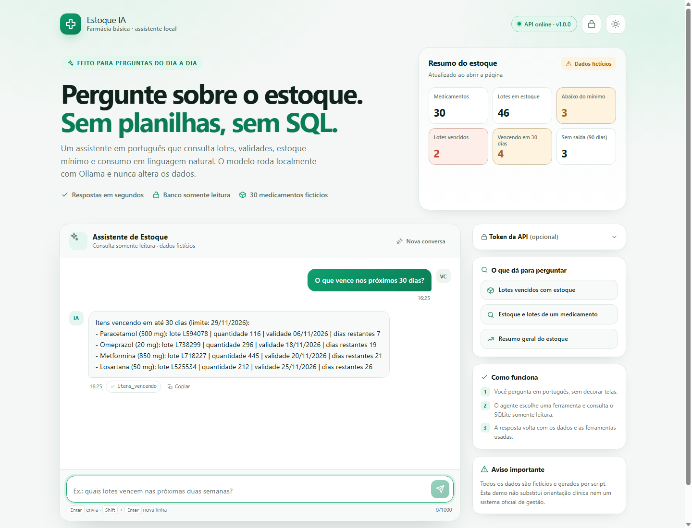
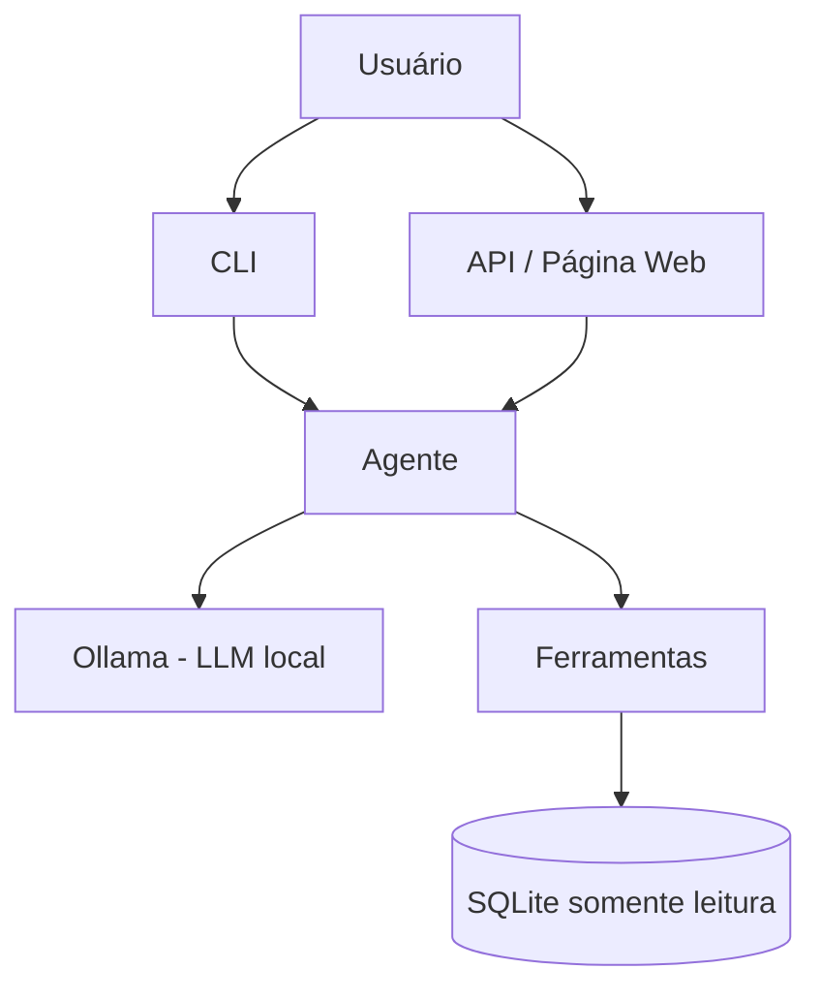

# Estoque IA

Agente de IA para consultar, em linguagem natural, o estoque fictício de uma farmácia básica de unidade de saúde.


> **Aviso:** Todos os dados são fictícios, gerados por script. Nunca utilize dados reais.

## O que é e para que serve

O Estoque IA permite fazer perguntas sobre o estoque em português do Brasil e obter respostas baseadas em dados do banco SQLite. O agente escolhe a ferramenta adequada usando tool calling, valida entradas e nunca escreve no banco.

Exemplos:

- "O que vence nos próximos 30 dias?"
- "Quais itens estão abaixo do mínimo?"
- "Qual o consumo médio de Losartana nos últimos 3 meses?"
- "Quais medicamentos estão parados há mais de 90 dias?"

## Demonstração



<!-- GIF da demo: docs/demo.gif -->

Uma transcrição de execução real está em [docs/demo.md](docs/demo.md). O GIF será
adicionado depois de uma gravação real da página ou do terminal.

## Arquitetura



Ciclo de tool calling:

1. Usuário faz pergunta em linguagem natural.
2. Agente envia pergunta e ferramentas ao Ollama.
3. Modelo decide chamar uma ferramenta com argumentos.
4. Ferramenta consulta SQLite com SQL parametrizado e retorna JSON.
5. Agente envia o resultado ao modelo e retorna a resposta em português.

Perguntas frequentes (vencimentos, mínimo, consumo, itens parados, resumo, busca e
orientação clínica) também têm um roteamento determinístico. Ele reduz a latência e
mantém a resposta estável mesmo quando o modelo local varia; perguntas fora desse
conjunto seguem o ciclo de tool calling acima.

## Ferramentas

| Ferramenta | O que faz | Parâmetros |
|---|---|---|
| buscar_medicamento | Busca por nome e mostra lotes/situação | nome |
| itens_vencendo | Lista lotes vencendo em até N dias | dias |
| itens_vencidos | Lista lotes vencidos com quantidade > 0 | nenhum |
| abaixo_do_minimo | Lista medicamentos abaixo do estoque mínimo | nenhum |
| consumo_medio | Calcula consumo médio e autonomia estimada | nome, meses |
| sem_saida | Lista medicamentos sem saída nos últimos N dias | dias |
| resumo_estoque | Resumo consolidado do estoque | nenhum |

## Decisões de projeto e segurança

- Modelo de IA executado localmente com Ollama.
- LLM nunca escreve SQL; apenas chama funções Python.
- SQL parametrizado.
- Banco SQLite em modo somente leitura pelo agente/API quando aplicável.
- Validação de entradas e limites de iterações.
- Prompt com escopo restrito; resultados das ferramentas tratados como dados.
- Token opcional via `X-API-Token`.
- Chaves e configurações locais mantidas no `.env`.
- Dados totalmente fictícios.

## Como rodar

### Requisitos

- Python 3.11 ou superior.
- [Ollama](https://ollama.com/download).
- Modelo `llama3.2:1b` (leve, padrão) ou `qwen2.5:3b` (respostas melhores, mais memória).

### 1. Preparar o Ollama

Instale o Ollama e execute:

```bash
ollama pull llama3.2:1b
```

Confirme que o modelo está disponível:

```bash
ollama list
```

O Ollama deve estar em execução no endereço:

```text
http://localhost:11434
```

### 2. Executar localmente

Crie e ative o ambiente virtual:

```powershell
python -m venv .venv
.venv\Scripts\activate
```

Instale as dependências:

```bash
pip install -e ".[dev]"
```

Crie o arquivo `.env` a partir do exemplo:

```powershell
Copy-Item .env.example .env
```

Configure o `.env`:

```env
OLLAMA_BASE_URL=http://localhost:11434
OLLAMA_MODEL=llama3.2:1b
ESTOQUE_DB_PATH=data/estoque.db
MAX_ITERACOES=5
API_TOKEN=
```

Prepare o banco fictício:

```bash
python -m estoque_ia.seed --force
```

Inicie a API:

```bash
uvicorn estoque_ia.api:app --reload
```

Em outro terminal, execute perguntas:

```bash
estoque-ia perguntar "O que vence nos próximos 30 dias?"
estoque-ia chat
estoque-ia ferramentas
```

### 3. Docker

Com Ollama instalado e em execução no computador:

```bash
docker compose up -d --build
```

O Docker Compose utiliza `host.docker.internal` para acessar o Ollama executado no computador host.

As perguntas de exemplo funcionam pelo roteamento mesmo sem Ollama. O modelo local
só é necessário para perguntas livres ou fora do conjunto conhecido.

### 4. Testar API

```bash
curl http://localhost:8000/saude
curl http://localhost:8000/resumo
```

Exemplo de pergunta:

```bash
curl -X POST http://localhost:8000/perguntar \
  -H "Content-Type: application/json" \
  -d "{\"pergunta\":\"O que vence nos próximos 30 dias?\"}"
```

Com token:

```bash
curl -X POST http://localhost:8000/perguntar \
  -H "Content-Type: application/json" \
  -H "X-API-Token: seu-token" \
  -d "{\"pergunta\":\"Resumo do estoque\"}"
```

## Testes e avaliação

Verificações automatizadas:

```bash
ruff check .
ruff format --check .
pytest -q
```

Avaliação offline:

```bash
python -m estoque_ia.avaliacao
```

Avaliação online com Ollama, no modo de produção (com roteamento determinístico):

```bash
python -m estoque_ia.avaliacao --online --saida docs/avaliacao.md
```

Resultado medido com `llama3.2:1b`: 12 de 12. Para medir apenas o LLM, sem o
roteador, use `--sem-roteamento`. O último resultado medido nesse modo foi 6 de 12
(50%) e está registrado em [docs/avaliacao-llm-puro.md](docs/avaliacao-llm-puro.md). Os números
não são escondidos: a diferença mostra quanto da confiabilidade vem do roteador e
quanto vem do modelo local.

A avaliação online requer Ollama em execução e o modelo configurado disponível localmente.

## Artigo técnico

O relato das decisões de arquitetura, do ciclo de tool calling, das limitações do
modelo local e do processo de avaliação está em
[docs/artigo-tecnico.md](docs/artigo-tecnico.md).

## Estrutura de pastas

```text
estoque-ia/
├── src/estoque_ia/
│   ├── __init__.py          # versão do pacote
│   ├── __main__.py          # python -m estoque_ia
│   ├── agente.py            # ciclo de tool calling e cliente Ollama
│   ├── api.py               # FastAPI, token e página web
│   ├── avaliacao.py         # avaliação offline e online
│   ├── cli.py               # comandos de terminal
│   ├── config.py            # leitura do .env
│   ├── db.py                # esquema e conexão SQLite
│   ├── esquemas.py          # schema das ferramentas e execução
│   ├── ferramentas.py       # consultas read-only validadas
│   ├── formatacao.py        # JSON da ferramenta vira texto amigável
│   ├── roteamento.py        # atalhos e guardas de escopo
│   ├── seed.py              # gerador determinístico de dados fictícios
│   ├── texto.py             # normalização sem acento
│   └── static/index.html    # interface web
├── tests/                   # pytest, fakes e fixtures
├── avaliacao/casos.json     # 12 perguntas com resposta esperada
├── docs/                    # artigo, demo, avaliações e screenshot
├── .github/workflows/ci.yml # testes + Docker no GitHub Actions
├── Dockerfile
├── docker-compose.yml
└── README.md
```

## Qualidade e organização

- O backend é separado por responsabilidade: banco, ferramentas, roteamento,
  formatação, agente, API, CLI e avaliação.
- Testes não usam rede nem chave: o `FakeLLM` cobre o ciclo de tool calling.
- O CI roda Ruff, pytest e avaliação offline em Python 3.11 e 3.12.
- O job de Docker sobe a imagem e confere `/saude` e `/resumo`.

## Problemas comuns

- **`Banco nao encontrado`**: rode `python -m estoque_ia.seed --force`.
- **Pergunta livre retorna erro do Ollama**: confira `ollama ps` e se
  `http://localhost:11434` responde. As perguntas de exemplo continuam funcionando.
- **Porta 8000 ocupada**: pare o processo antigo ou use `--port 8001`.

## Limitações conhecidas e próximos passos

- Estoque atual inclui lotes vencidos.
- Sem memória de conversa.
- Sem rate limit.
- Apenas SQLite.
- Sem tela de login.
- Ideias: histórico de conversa, alertas automáticos via n8n e gráficos.

## Deploy opcional em VM (Oracle Cloud Always Free)

1. Instalar Docker e Ollama na VM.
2. Clonar o repositório.
3. Baixar o modelo com `ollama pull llama3.2:1b`.
4. Configurar `.env` com as variáveis do Ollama e, opcionalmente, `API_TOKEN`.
5. Executar `docker compose up -d --build`.
6. Liberar a porta 8000 na Security List e no firewall da VM.
7. Testar `/saude`.

## Autor

Emanuel Vitor Fernandes Nascimento - [GitHub](https://github.com/evfernandes-dev)

## Licença

MIT
